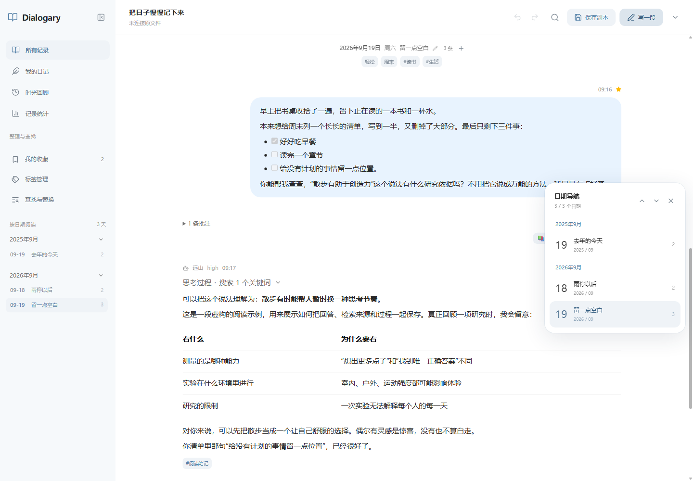
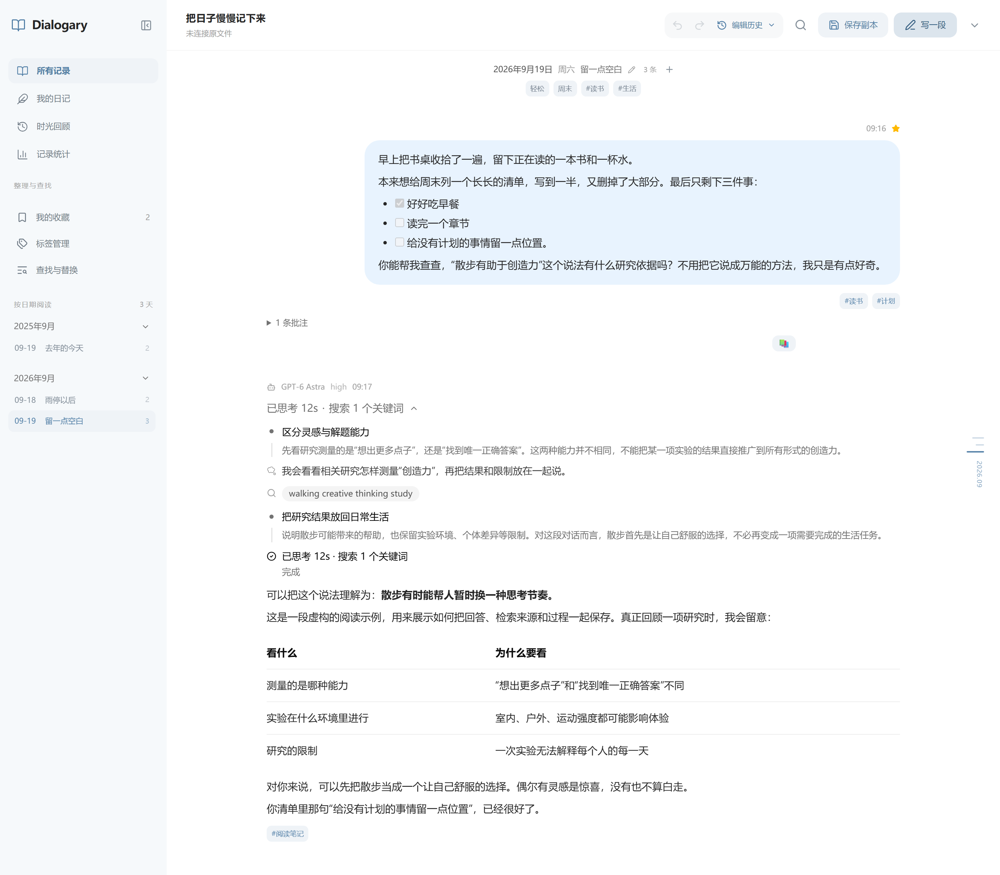
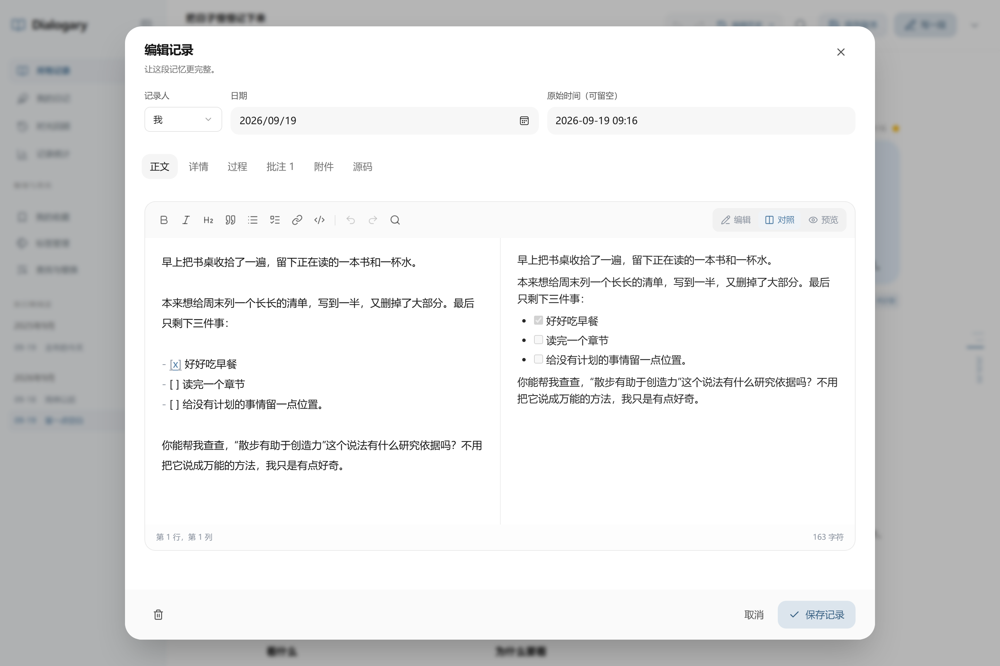
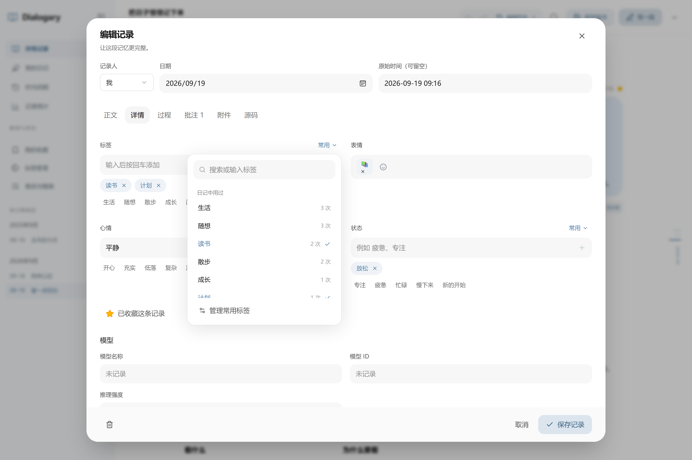
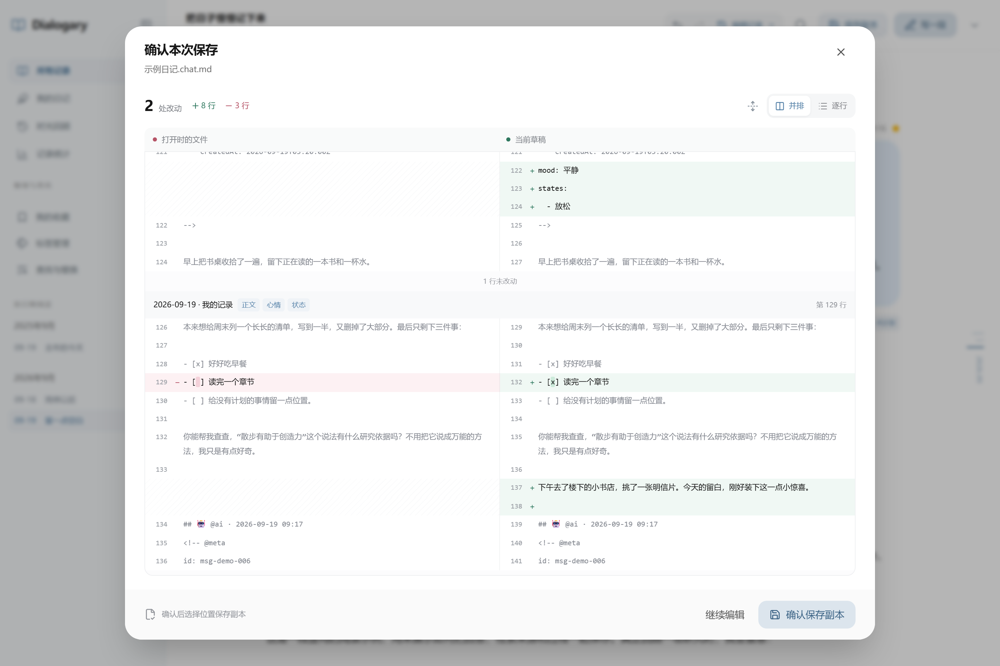
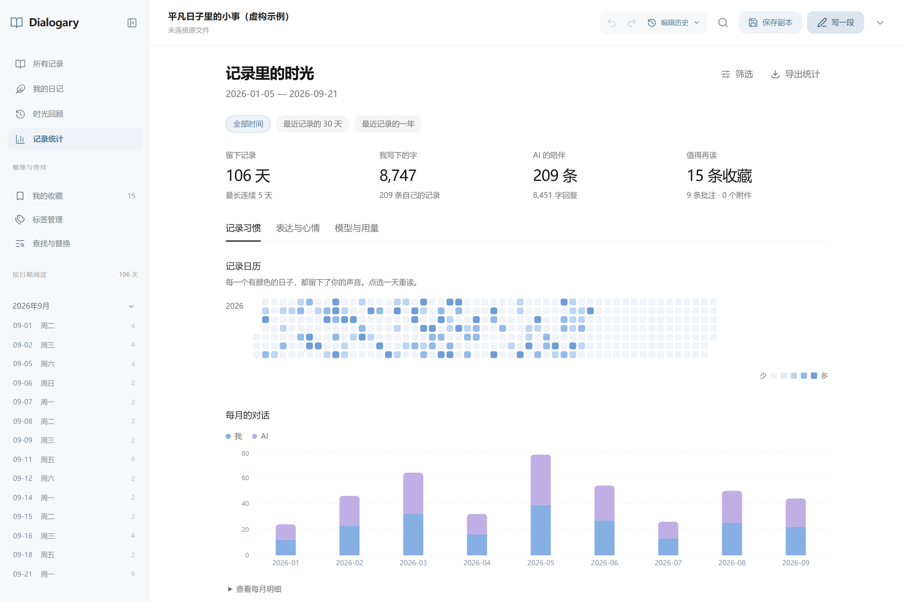

# Dialogary

**把与 AI 的长期对话，留成一本可以不断补写的日记。**

Dialogary 是一个本地优先的对话日记阅读器与编辑器。用一份 `.chat.md` 保存聊天、生活片段和当时的感受，在网页中阅读、整理、编辑和回顾，也能随时回到 Typora 或普通文本编辑器继续书写。

无需账号，无后端，不调用模型 API。Markdown 文件与附件由你自己保管。

[项目初衷](#项目初衷) · [开始使用](#开始使用) · [功能预览](#功能预览) · [保存与备份](#保存与备份) · [格式规范](chatlog-md-格式规范.md) · [v1 迁移](#从-v1-迁移)

<picture>
  <source media="(prefers-color-scheme: dark)" srcset="docs/screenshots/v2-dark.png">
  <source media="(prefers-color-scheme: light)" srcset="docs/screenshots/v2-light.png">
  
</picture>

## 项目初衷

我常常和 AI 聊生活、想法、感受以及谈心。有时，对话本身就成了一种日记：今天经历了什么，当时为什么难过，某个想法又是怎样一点点变清楚的，都留在这些来回的文字里。时间久了，这些记录对我来说越来越珍贵。

但我使用的 AI 平台并不固定，也会经常切换账号。同一段生活的记录，就这样散落在不同的地方。为了把它们留在自己手里，我开始将聊天整理成 Markdown 文件，用 Typora 阅读和维护。文件可以随时打开、手动补写，也方便自己备份和长期保存。

随着记录增多，我希望能有更适合回顾它们的方式。比如只看自己发出的内容，像翻阅日记一样看看过去的自己；需要时再展开 AI 的回应，找回当时的对话。也希望能为一段话添上标签，记下那天的心情，或者在多年后重读时留下一条批注。

Dialogary 就从这个需求出发：为这些对话建立一套人容易读写、程序能够准确解析、也能继续扩展的 Markdown 规范，再围绕它做一个好用的阅读与编辑工具。即使以后换了平台、账号，或有了新的查看工具，这些文字仍然是一份由自己保存、可以继续阅读和整理的生活记录。

## 开始使用

```bash
npm install
npm run dev
```

1. 打开终端显示的地址，默认为 [localhost:5173](http://localhost:5173)。
2. 先访问 [示例日记](http://localhost:5173/?demo) 体验，或从右上角「更多操作」新建日记、打开本地 `.chat.md`。
3. 日记带有图片或文件时，选择「打开文件夹」，一并载入日记与附件。也可以直接拖入文件或文件夹。

示例中的修改保存在浏览器草稿中；[重置示例](http://localhost:5173/?demo&reset) 可以重新载入原始内容。

开发与预览服务监听 `0.0.0.0`，同一局域网的手机、平板可通过终端显示的 Network 地址访问。直接写回本地文件需要浏览器支持文件系统接口并获得授权，通常需使用 Chrome / Edge 的 localhost 或 HTTPS 页面；其他情况可下载副本或附件归档。详见[保存与备份](#保存与备份)。

## 功能预览

### 对话可以完整保存，也可以只读自己的日记

在「所有记录」中阅读完整对话，在「我的日记」中专注于自己写下的文字，需要时再展开 AI 回复。日期目录与右侧日期轴帮助快速回到某一天；收藏、全文搜索和组合筛选让长日记也容易查找。

- **保留完整表达**：Markdown、数学公式、代码高亮、表格、脚注和 Mermaid 图。
- **留住对话过程**：推理时长、思考内容、过程说明与检索步骤，沿用 HappyChat 的渲染与样式。
- **轻松看图**：多图按原始比例排列，点击进入灯箱查看原图、文件名或下载。
- **按习惯阅读**：浅色、深色、跟随系统，五种清淡界面配色与 HappyChat 消息配色，可调整阅读宽度和字号。

文档按**文件中的顺序**展示，允许补记、重复日期和非递增时间。首次打开停在末尾，之后恢复阅读位置。

<details>
<summary>查看思考与检索过程</summary>

<picture>
  <source media="(prefers-color-scheme: dark)" srcset="docs/screenshots/v2-process-dark.png">
  <source media="(prefers-color-scheme: light)" srcset="docs/screenshots/v2-process-light.png">
  
</picture>

</details>

### 写下正文，也照顾每一个细节

记录编辑器提供 Markdown 着色、格式工具栏、正文搜索，以及编辑、对照、预览三种视图。正文之外，时间、模型、Token 用量、过程、批注与附件都可以独立编辑；也可直接查看完整 JSON 数据。

<picture>
  <source media="(prefers-color-scheme: dark)" srcset="docs/screenshots/v2-editor-dark.png">
  <source media="(prefers-color-scheme: light)" srcset="docs/screenshots/v2-editor-light.png">
  
</picture>

用标签、表情、心情、状态和收藏标记当时的自己。常用项可以添加、重命名、移除，也会从文档中发现已经用过的内容。选中文字即可在选区旁添加批注；附件支持拖动、键盘和指定位置排序。

<details>
<summary>查看标签、心情、状态与模型信息的编辑界面</summary>

<picture>
  <source media="(prefers-color-scheme: dark)" srcset="docs/screenshots/v2-organize-dark.png">
  <source media="(prefers-color-scheme: light)" srcset="docs/screenshots/v2-organize-light.png">
  
</picture>

</details>

还可以批量整理记录、合并标签、设置标签颜色，或通过「查找与替换」逐项核对要修改的文字。日期本身也能拥有标题、标签、心情、状态和备注。

### 每次保存，都能看清改了什么

保存前先对照打开时或上次保存后的文件：按记录查看变化、切换并排或逐行差异、展开上下文，中文修改也有行内高亮。原文未修改的片段保持原样，普通附件简写无需改成复杂内容块。

<picture>
  <source media="(prefers-color-scheme: dark)" srcset="docs/screenshots/v2-changes-dark.png">
  <source media="(prefers-color-scheme: light)" srcset="docs/screenshots/v2-changes-light.png">
  
</picture>

顶部的撤销、重做与「编辑历史」会显示操作名称和具体变化。文档历史随浏览器草稿保留，刷新后可以继续撤销、重做；保存文件不会清空历史。编辑器内尚未提交的正文也有独立的撤销记录。

### 回顾生活，也看见记录的变化

「时光回顾」提供往年今日和随机翻阅；「记录统计」展示记录日历、自己写下的字数、对话趋势、记录时段，以及标签、心情、状态、模型与 Token 用量。切换时间范围，并从相关图表返回那段记录。

<picture>
  <source media="(prefers-color-scheme: dark)" srcset="docs/screenshots/v2-stats-dark.png">
  <source media="(prefers-color-scheme: light)" srcset="docs/screenshots/v2-stats-light.png">
  
</picture>

## 保存与备份

**浏览器草稿与磁盘文件是两回事。** 修改会自动保存为当前浏览器的草稿；点击顶部保存按钮或按 `Ctrl / ⌘ + S`，核对差异并确认后，才会写入文件或保存副本。

| 打开方式 | 如何保存 |
| --- | --- |
| 通过受支持浏览器的「打开文件」授权原件 | 确认差异后直接写回该文件 |
| 通过「打开文件夹」授权日记目录 | 写回日记，并保存新增附件；写入前版本保留在 `.dialogary-backups/` |
| 普通上传、示例日记或自动加载的网页数据 | 选择位置另存，或下载副本；不会仅凭文件名覆盖原件 |
| 含本地附件的日记另存到新位置 | 导出 ZIP，将 Markdown 与所引用的附件一起带走 |

从其他编辑器切回页面时，会核对已连接的文件：草稿没有改动时直接载入新内容（可撤销），已有改动时保留草稿，让你查看双方内容、载入磁盘版本、下载草稿或另存。已授权文件夹中附件的新增与替换同步更新；也可以从「更多操作 → 重新载入文件」主动检查。保存时同样核对，写回后会重新读取文件确认内容。

找不到的附件汇总在顶部的提示中，可逐条定位到记录，或重新选择附件所在的文件夹。

草稿、常用项、阅读位置和编辑历史保存在当前浏览器中，**不提供跨设备自动同步**。清除站点数据会移除这些本地数据；长期保存请保留 Markdown、附件及独立备份。

<details>
<summary>草稿、历史版本与导出方式</summary>

- **未完成的编辑**：关闭记录编辑器时，可以继续编辑、保留草稿并关闭，或放弃修改。
- **最近打开的日记**：从更多操作找回其他文件的工作区。
- **编辑历史**：查看每一步差异，区分已应用与已撤销的操作。撤销后进行新的修改，会清除原重做分支。
- **历史版本**：保留最近 30 个快照，可对照、下载或恢复；恢复本身也能撤销。
- **高级编辑**：「编辑记录 → JSON」修改这条记录的完整数据；「编辑整个文件」修改完整 Markdown，保存前检查格式。

「导出与归档」支持全部记录、当前筛选结果或已选择的记录：

| 格式 | 用途 |
| --- | --- |
| 完整 Markdown | 保留模型、过程、标签、心情、批注与扩展字段，继续编辑 |
| 含附件归档 | 将 Markdown 与本地附件打包为 ZIP，迁移与备份 |
| 我的日记 | 只导出自己写下的文字，作为阅读稿 |
| 结构化 JSON | 导出可解析数据，不含内部原文缓存 |
| 自定义阅读稿 | 使用模板调整标题、元信息、角色、日期范围及思考／附件开关 |

新增附件需要一同保存：已授权目录可以写入附件，其他情况使用「含附件归档」。阅读稿适合重读与分享；长期保存使用完整 Markdown 或 ZIP。

</details>

## 一份可手写、可扩展的 Markdown

`chatlog-md/2` 的基本结构很简单：文件头、日期标题、消息头与正文。星期由界面生成，记录编号、模型和 Token 信息都不是手写的前提。

```markdown
---
format: chatlog-md/2
title: 我的对话日记
timezone: Asia/Shanghai
---

# @2026-09-19

## 🧑‍💻 @user · 2026-09-19 21:30

今天走了一条不熟悉的小路，抬头看到了很好看的云。

🖼️ [路边的云.jpg](assets/clouds.jpg)

## 🤖 @ai

把这个片刻留下来，以后再读时，或许还会想起当时的天空。
```

在末尾继续追加消息或日期节即可，不需要重新编号或调整其他记录。跨文件复制时，带上完整记录与元数据，保留目标文件唯一的文档头，并确保附件相对路径有效。已有 ID 的副本应使用不同 ID，避免冲突。

<details>
<summary>添加标签、心情、模型与 Token 元数据</summary>

元数据放在消息头之后的 YAML 注释中。普通文本编辑器可以直接修改，Typora 阅读时隐藏这些信息：

```markdown
<!-- @meta
tags: [散步, 生活]
mood: 平静
states: [放松]
reactions: [☁️]
model:
  id: example-model
  name: 示例模型
reasoning:
  effort: high
usage:
  input_tokens: 1200
  output_tokens: 300
  cache_read_tokens: 800
  cache_write_tokens: 200
  reasoning_tokens: 100
-->
```

**输入量包含缓存读写，输出量包含推理 Token。** 汇总时不重复加上这些明细。缺失表示未记录，`0` 表示实际为零；统计会展示用量数据的覆盖情况。

复杂回复可按原顺序记录正文、推理、过程说明、检索与附件。未知字段和未知内容块会保留，便于未来扩展。

</details>

阅读 [v2 格式规范](chatlog-md-格式规范.md)，或直接参考[完整 v2 示例](examples/示例日记-v2.chat.md)与[v1 示例](examples/示例日记.v1.chat.md)。

## 从 v1 迁移

应用继续读取 v1；首次编辑时会核验转换结果，再使用 v2。对于重要原件，可以先运行独立脚本，生成备份、候选文件与核验报告：

```bash
# 只读检查，不生成文件
npm run chatlog:migrate -- "旧日记.chat.md" --dry-run

# 生成 v1 字节备份、v2 候选与核验报告
npm run chatlog:migrate -- "旧日记.chat.md"
```

默认输出到 `.tmp/migration/<原件哈希前缀>/`，**不覆盖输入文件，也不覆盖已有候选和报告**。核验通过后再切换正式文件，并长期保留 v1 原件。

<details>
<summary>指定输出、核验已有候选与附件路径</summary>

```bash
# 自定义输出位置
npm run chatlog:migrate -- "旧日记.chat.md" --out ".tmp/候选.v2.chat.md" --report ".tmp/迁移报告.json"

# 重新核验已有候选
npm run chatlog:migrate -- "旧日记.chat.md" --verify ".tmp/候选.v2.chat.md"

# 原件备份与附件不在同一目录时，指定附件所在的日记目录
npm run chatlog:migrate -- "备份/旧日记.chat.md" --verify ".tmp/候选.v2.chat.md" --asset-root "日记目录"
```

脚本核对消息语义、原始文本片段、全文允许变更、附件存在性与 SHA-256，以及 v2 解析／写回的一致性。迁移只修改版本声明与纯星期日期标题，不整理正文或补造历史信息。

`--asset-root` 只改变附件核验基准，不修改路径或文件；默认以输入 v1 所在目录查找附件。

[v1 规范](docs/archive/chatlog-md-v1.md)与参考解析器仍保留。真实记录和报告应放在 Git 忽略的目录；`.tmp/` 用于候选与临时报告，长期备份请另行保管。

</details>

## 部署与数据边界

推荐启动网页后打开本地文件。文本编辑与统计在浏览器中完成；正文中的远程图片、链接仍可能访问对应网站。

也可以将日记与附件放在 `public/data/`，由开发服务器自动加载：

```text
public/data/
├── 我的日记.chat.md
└── assets/
    └── clouds.jpg
```

**`public/data/` 被 Git 忽略，但 Vite 仍会把它复制进 `dist/`。** 发布空白阅读器时，请使用不含私人数据的工作副本构建。部署带数据的 `dist/` 会同时部署日记和附件，访问权限由服务器控制。

```bash
npm run build
npm run preview
```

`dist/` 可放到静态服务器的根目录或子目录，不要直接双击 `dist/index.html`。局域网 HTTP 页面通常不能直接写回本地文件，可以下载保存；手机上的修改不会自动写回电脑原件。

## 开发

React 19 · TypeScript · Vite 8 · Tailwind CSS 4 · CodeMirror 6 · Zustand

```bash
npm run typecheck
npm test
npm run build
npm run parse:check -- "文件.chat.md"
```

测试使用虚构数据，覆盖 v1/v2 兼容、保真写回、迁移、编辑历史、Token 统计、附件处理与保存恢复。

<details>
<summary>目录结构与本地文件校验</summary>

```text
src/
├── parser/      v1/v2 解析、保真写回、迁移验证与格式检查
├── model/       编辑操作、历史、派生数据、检索与统计
├── data/        文件授权、附件解析、IndexedDB 草稿与恢复
├── editor/      记录、日期、标签、批注、过程与查找替换
├── markdown/    HappyChat Markdown 渲染
├── process/     HappyChat 检索过程结构
├── export/      完整归档、JSON 与阅读稿模板
└── components/  阅读、管理、统计与回顾界面
scripts/
├── chatlog-migrate.ts  v1 → v2 转换与核验
└── chatlog_parse.py    v1 Python 参考解析器
```

可显式指定本地文件进行额外往返校验：

```powershell
$env:CHATLOG_FILE = "C:\日记目录\我的日记.chat.md"
npm test
```

`python scripts/chatlog_parse.py "文件.chat.md"` 是仅用于 v1 的参考实现；完整 v2 使用 TypeScript 解析器。

私人记录、聊天内容、附件和核验报告不应进入提交。项目提供 `public/data/`、`.devfiles/`、`.tmp/` 等忽略目录，临时文件统一放在 `.tmp/`。

</details>

<details>
<summary>常用快捷键</summary>

| 快捷键 | 功能 |
| --- | --- |
| `Ctrl / ⌘ + K` | 搜索记录 |
| `Ctrl / ⌘ + S` | 查看保存前差异 |
| `Ctrl / ⌘ + Z` | 撤销；输入框中遵循文本编辑行为 |
| `Ctrl / ⌘ + Shift + Z` / `Ctrl + Y` | 重做 |
| 正文编辑器 `Ctrl / ⌘ + B / I / K` | 加粗／斜体／链接 |
| 正文编辑器 `Ctrl / ⌘ + F` | 查找正文 |
| 编辑记录时 `Ctrl / ⌘ + Enter` | 保存这条记录 |
| 灯箱内 `←` / `→` / `Esc` | 切换图片／关闭 |

</details>
