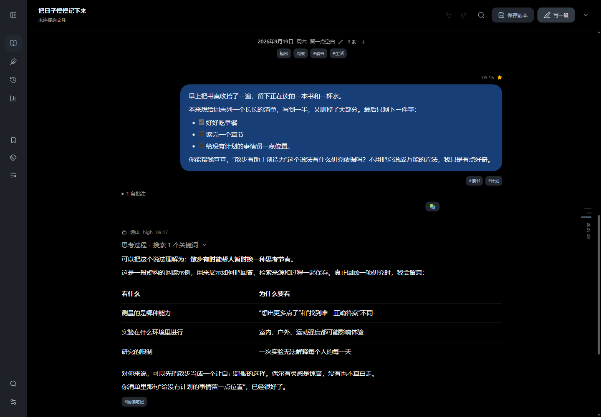

# Dialogary

**把与 AI 的长期对话，整理成可以不断补写、回顾的私人日记。**

Dialogary 是一个本地优先的 Markdown 日记编辑器。以 `.chat.md` 文件保存完整内容，网页提供阅读、编辑、标签、批注、检索、统计和回顾；离开网页后，仍可用 Typora 或普通编辑器维护。

React 19 · TypeScript · Vite 8 · Tailwind CSS 4 · 无后端

| 浅色 | 深色 |
| --- | --- |
|  |  |

## 开始使用

```bash
npm install
npm run dev
```

打开 [localhost:5173](http://localhost:5173)。无需准备真实记录，可以先访问 [虚构示例](http://localhost:5173/?demo) 体验全部功能；[重置示例](http://localhost:5173/?demo&reset) 重新载入示例原文。

开发和预览服务均监听 `0.0.0.0`。同一局域网中的设备可用终端显示的 Network 地址打开。

推荐通过右上角「更多操作」打开本地文件：

- **打开文件**：选择一份 `.chat.md`，开始阅读和编辑。
- **打开文件夹**：选择日记及其附件所在目录，同时加载本地图片和文件。日记位于子目录时，附件仍以日记所在目录为基准。
- **新建日记**：从今天开始写，也可以修改日期补写过去。
- **拖入文件或文件夹**：作为另一种打开方式。

Chrome / Edge 等支持文件系统接口的浏览器，在 localhost 或 HTTPS 下授权后可以直接写回文件。其他浏览器仍可完整编辑，通过下载 Markdown 或 ZIP 归档保存。手机浏览器中的修改不会自动同步到电脑原文件。

## 日常阅读与整理

| 想做什么 | 从哪里开始 |
| --- | --- |
| 像看日记一样只读自己的文字 | 左侧「我的日记」，需要时展开 AI 回复上下文 |
| 查看完整对话与过程 | 左侧「所有记录」，展开思考、commentary 和检索步骤 |
| 补写、插入、复制、移动或删除记录 | 顶部「写一段」或消息旁的操作按钮 |
| 修改模型、时间、Token、标签、表情、心情和状态 | 「编辑记录」→「详情」 |
| 修改推理、过程说明、检索数据与顺序 | 「编辑记录」→「过程」 |
| 写批注或记录读后感 | 消息批注入口；选中文字后，在选区旁的小菜单添加批注 |
| 整理某一天的标题、心情、状态与备注 | 日期标题旁的编辑入口 |
| 重命名、合并标签并设置颜色 | 左侧「标签管理」 |
| 修改日记名称、时区或管理常用筛选 | 点击顶部日记名称，打开「日记设置」 |
| 一次整理多条记录 | 「批量选择」或更多操作中的「批量整理」 |
| 精确查找并修改历史文字 | 左侧「查找与替换」，预览命中后选择要替换的项目 |

正文支持 Markdown、数学公式、代码高亮、表格、脚注、Mermaid 图和图片灯箱。Markdown 与推理过程沿用 HappyChat 的渲染和样式，有记录的思考时长会显示具体秒数。消息气泡按实际行数调整上下留白。多张图片可并排查看，预览保留原始比例并限制大小；点击后查看大图、文件名及下载入口。

「外观与阅读」提供晴空蓝、雾紫、浅樱、暖沙、云灰五种清淡配色。消息气泡完整沿用 HappyChat 的七种浅深色配色，阅读宽度默认 960 px，也可选择紧凑、舒展、宽屏或自由调整。

日期目录、右缘日期轴和正文都保持文件中的顺序，不要求时间单调递增。首次打开停在文档末尾，之后恢复阅读位置。侧栏折叠后保留图标导航；鼠标移到右侧边缘展开日期轴，支持方向键、Home / End 定位，手机可点击日期入口。

表情选择器会自动列出日记里用过的表情。点击「管理」可收藏或移除常用项，也可输入自定义表情；常用收藏保存在当前浏览器中，贴到记录上的表情保存在日记文件里。

标签、心情和状态也支持常用项管理，可添加、重命名、移除，并从文档中发现已用内容。移除常用项不会修改已有记录。在编辑字段或「标签管理」中可打开管理入口。

「搜索记录」可查正文、推理、过程说明、批注和标签，并跳转到原文。「筛选记录」可以组合日期、角色、模型、标签、心情、状态、收藏、批注和附件条件。常用组合可以命名后保存到侧栏。

「时光回顾」提供往年今日和随机翻阅，可限定日期与话题。「记录统计」展示记录日历、表达量、习惯、模型与 Token、标签、心情和状态；可切换时间范围，并从相关图表回到记录。

## 保存、撤销与恢复

顶部状态会区分**浏览器草稿**与**磁盘文件**：

1. 网页中的修改自动保存为当前浏览器的草稿。
2. 点击顶部保存按钮或按 `Ctrl / ⌘ + S`，先核对与打开时／上次保存文件的差异。支持并排与逐行对照、中文行内高亮和展开完整上下文。确认后才写回已连接的文件，或另存副本。
3. 新增附件需要连同日记保存。已授权日记目录可写入附件；其他情况使用「导出与归档」→「含附件归档」。
4. 含本地附件的日记另存到新位置时，使用 ZIP 归档保持路径完整。

草稿不等于独立备份，清除浏览器站点数据会移除草稿。长期保存以 Markdown、附件和另行备份为准。

自动从 `public/data/` 加载或普通上传的记录没有原文件写入权限，此时顶部显示「保存副本」：选择新的保存位置，或下载 Markdown／ZIP。网页不会仅凭文件名自动覆盖电脑里的原件。想直接编辑原件，请先通过「打开文件／文件夹」选择本地日记。

更多操作中的「最近打开的日记」可找回其他文件的工作区；编辑框内未完成的草稿也会保留在当前浏览器。顶部「编辑历史」列出每一步操作和具体的前后差异，区分已应用与已撤销的步骤。文档历史随草稿保存在当前浏览器，刷新后仍可撤销、重做；恢复到旧状态后进行新的修改，会开启新的分支并清除原重做分支。保存文件不会清空编辑历史，撤销到保存前的内容也会重新标记为待保存。「历史版本」保留最近 30 个快照，可对照、下载和恢复；恢复动作本身也能撤销。

记录编辑器居中显示，切换正文、详情等标签页时保持固定高度。正文支持 Markdown 语法着色、格式工具栏、搜索和编辑／对照／预览三种视图，切换标签页保留正文的输入历史。编辑器中的撤销针对尚未提交的正文；点击「保存记录」后，整条记录的变更成为文档历史的一步。附件可以拖动排序，也可聚焦手柄后用空格与方向键移动，或直接选择目标位置。关闭未完成的编辑时，可以继续编辑、保留草稿并关闭或放弃修改。记录人选项只提供「我」和「AI」。

若 Typora 等程序修改了磁盘文件，保存时会提示冲突，并保留当前草稿。可以查看双方内容、下载草稿、载入磁盘版本或另存。通过授权目录保存时，应用会在该目录的 `.dialogary-backups/` 留下写入前版本；该目录不会被当成附件重新载入。

高级修改入口：

- **编辑记录 → 源码**：修改该消息的完整 JSON 数据，包括扩展字段，也可切换到彩色 JSON 预览。
- **更多操作 → 编辑整个文件**：直接修改完整 Markdown，保存前检查格式。

## 导出与归档

「导出与归档」支持全部记录、当前筛选结果和已选择的记录：

| 格式 | 保存内容 |
| --- | --- |
| 完整 Markdown | v2 原本，包括模型、过程、标签、心情、批注与扩展字段 |
| 含附件归档 | Markdown 与所引用的本地附件 ZIP；缺少附件时提示处理 |
| 我的日记 | 只包含自己文字的阅读稿 |
| 结构化 JSON | 完整可解析数据，不包含内部原文缓存 |

「自定义阅读稿」保留模板导出，可调整标题、元信息、角色、日期范围和思考／附件开关。阅读稿适合分享或重读；完整 v2 或 ZIP 用于继续编辑与长期保存。

## chatlog-md/2

最简单的记录只需要文件头、日期与消息，星期由界面生成，ID 和详细元数据均可省略：

```markdown
---
format: chatlog-md/2
title: 我的日记
timezone: Asia/Shanghai
---

# @2026-09-19

## 🧑‍💻 @user · 2026-09-19 21:30

今天终于把一直惦记的事情做完了。

## 🤖 @ai

听起来，今天有一种终于可以松口气的感觉。
```

有需要时，在消息头后加入 YAML 注释。Typora 阅读时隐藏这些元数据，普通编辑器可以直接维护：

```markdown
<!-- @meta
tags: [生活, 随想]
mood: 平静
states: [有点累]
reactions: [🌱]
model:
  id: example-model
  name: 示例模型
reasoning:
  effort: high
usage:
  input_tokens: 1200
  output_tokens: 300
  cache_read_tokens: 800
  cache_write_tokens: 200
  reasoning_tokens: 100
-->
```

**输入量包含缓存读写，输出量包含推理 Token。** 汇总时不再次加上这些明细。缺失表示未记录，数字 0 才表示实际为零；统计会显示用量数据的覆盖情况。

直接在文件末尾追加日期节或消息即可，不需要重新编号。跨文件复制时，复制完整记录及其元数据，保留目标文件唯一的 YAML 文档头，并确保附件相对路径有效。未知字段和未知过程块会保留，未修改片段在写回时保持原样。

完整语法、交错过程、附件、转义和扩展规则见 [v2 格式规范](chatlog-md-格式规范.md)。示例：[完整 v2 日记](examples/示例日记-v2.chat.md)、[保留的 v1 日记](examples/示例日记.v1.chat.md)。

## 从 v1 迁移

应用继续读取 v1；首次编辑时先核验转换结果，再使用 v2。对重要原件，建议先使用独立脚本生成候选与报告。

先只读检查：

```powershell
npm run chatlog:migrate -- "原始.v1.chat.md" --dry-run
```

生成 v1 字节备份、v2 候选与报告：

```powershell
npm run chatlog:migrate -- "原始.v1.chat.md"
```

默认保存在 `.tmp/migration/<原件哈希前缀>/`。脚本**不会覆盖输入文件，也不会覆盖已有候选或报告**。另选输出位置：

```powershell
npm run chatlog:migrate -- "原始.v1.chat.md" --out ".tmp/候选.v2.chat.md" --report ".tmp/迁移报告.json"
```

重新核验已有候选：

```powershell
npm run chatlog:migrate -- "原始.v1.chat.md" --verify ".tmp/候选.v2.chat.md"
```

如果 v1 备份搬到了别处，附加 `--asset-root` 指向原日记所在目录，以原附件路径核验：

```powershell
npm run chatlog:migrate -- ".devfiles/backups/v1-before-v2/聊天记录.chat.md" --verify "public/data/聊天记录.chat.md" --asset-root "public/data"
```

不指定时，附件相对输入 v1 文件所在目录查找。该选项只改变核验基准，不修改任何附件路径或文件。

脚本核对消息语义、每条原始文本片段、全文允许变更、附件存在性和 SHA-256，以及 v2 解析／写回的一致性。迁移只修改版本声明与纯星期日期标题，不整理正文、不补造历史信息。全部核验通过后再切换正式文件，长期保留 v1 原件。

[v1 规范](docs/archive/chatlog-md-v1.md) 与 TypeScript、Python 参考实现仍在项目中。真实日记、聊天和迁移报告应保存在 Git 忽略的 `public/data/`、`.devfiles/` 或 `.tmp/`；其中 `.tmp/` 适合候选与临时报告，长期原件备份建议放在独立备份目录。

## 本地文件与带数据部署

推荐运行网页后打开自己的本地文件。应用无需登录，也不调用模型 API；文本编辑与统计在浏览器中完成。正文中的远程图片或链接仍可能访问对应网站。

也可以把日记放进 `public/data/`，让本地开发服务器自动读取：

```text
public/data/
├── 聊天记录.chat.md
└── assets/
    └── 照片.jpg
```

```bash
npm run build
npm run preview
```

**Vite 会把 `public/data/` 复制进 `dist/`。** Git 忽略只防止提交，不会排除构建内容。发布空白阅读器时，使用不含私人 `public/data/` 的工作副本构建；部署带数据的 `dist/` 会同时部署日记和附件，访问权限由你使用的服务器控制。

开发服务器允许同一局域网访问，可在手机打开 `http://电脑IP:5173` 阅读。浏览器文件写入接口通常要求 HTTPS 或 localhost；局域网 HTTP 下可使用下载保存。不要直接双击 `dist/index.html`，请通过开发服务器或静态服务器打开。

## 快捷键

| 快捷键 | 功能 |
| --- | --- |
| `Ctrl / ⌘ + K` | 搜索记录 |
| `Ctrl / ⌘ + S` | 查看保存前差异 |
| `Ctrl / ⌘ + Z` | 撤销；输入框中遵循文本编辑行为 |
| `Ctrl / ⌘ + Shift + Z` / `Ctrl + Y` | 重做 |
| 正文编辑器 `Ctrl / ⌘ + B / I / K` | 加粗／斜体／链接 |
| 正文编辑器 `Ctrl / ⌘ + F` | 查找正文 |
| 编辑记录时 `Ctrl / ⌘ + Enter` | 保存这条记录 |
| 灯箱内 `←` / `→` / `Esc` | 切换图片／关闭 |

## 开发与验证

```bash
npm run dev
npm run build
npm run preview
npm run typecheck
npm test
npm run parse:check -- "文件.chat.md"
```

测试使用虚构数据，覆盖 v1/v2 兼容、保真写回、迁移、编辑、Token 统计、附件路径与保存恢复边界。可显式指定本地文件运行额外往返校验：

```powershell
$env:CHATLOG_FILE = "C:\路径\聊天记录.chat.md"
npm test
```

`python scripts/chatlog_parse.py "文件.chat.md"` 是**仅用于 v1 的参考解析器**；完整 v2 使用 TypeScript 解析器。

```text
src/
├── parser/      v1/v2 解析、保真写回、迁移验证与格式检查
├── model/       工作区、编辑操作、派生数据、检索与统计
├── data/        文件授权、附件解析、IndexedDB 草稿与恢复
├── editor/      消息、日期、标签、批注、过程与查找替换
├── markdown/    HappyChat Markdown 渲染
├── process/     HappyChat 检索过程结构
├── export/      完整归档、JSON 与阅读稿模板
└── components/  阅读、管理、统计与回顾界面
scripts/
├── chatlog-migrate.ts  v1 → v2 安全转换
└── chatlog_parse.py    v1 Python 参考实现
```
