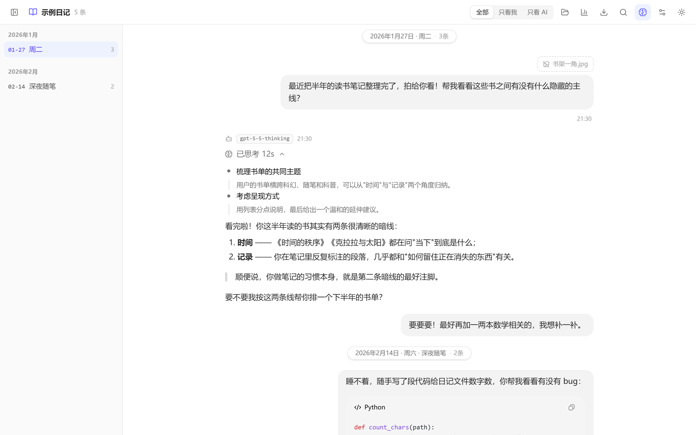
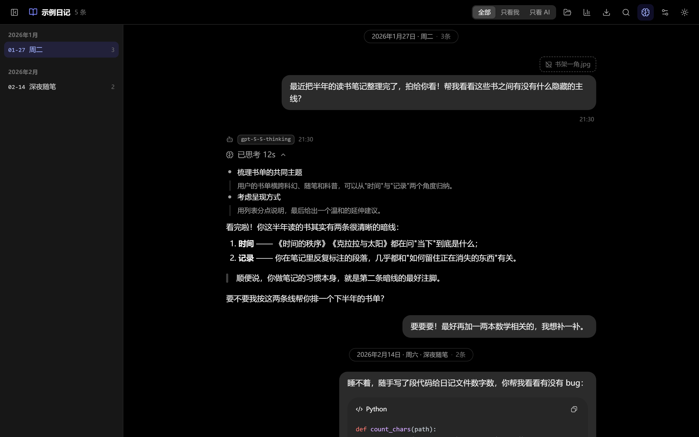

<div align="center">

# 📖 Dialogary

**把长期积累的 AI 对话日记，变成一本可读、可搜、可统计、可导出的书**

[chatlog-md](#-数据格式chatlog-md) 格式聊天记录的网页查看器 · 纯静态单页应用 · 无后端 · 数据不离开你的设备


| 浅色 | 深色 |
|:---:|:---:|
|  |  |

</div>

---

## ✨ 功能

**阅读**

- 富 Markdown 渲染：GFM、KaTeX 数学、代码高亮（带复制）、Mermaid 图、GitHub 风格 Alert、脚注、表格；`remark-cjk-friendly` 保证中文粗体/强调不断裂
- 对话式排版：我的消息右侧气泡，AI 回复全宽正文；模型名徽章、精度感知的时间显示（没有时分的老记录不硬凑时间）
- 🤔 **思考摘要** 默认折叠、点击展开，顶栏可一键展开全部
- 图片附件缩略图 + 全屏灯箱（←/→ 切换、Esc 关闭）
- 深色 / 浅色 / 跟随系统，切换无闪烁；深色模式为纯黑底
- 外观设置：7 种气泡颜色，正文宽度与消息字号滑杆无极调节，改动即时生效并自动记住

**导航与检索**

- 左侧大纲按月份分组，滚动时自动高亮当前日期，点击平滑滚动到当天（手机上是抽屉，桌面可拖拽调宽、动画折叠）
- 打开文件自动定位到最近一天——日记总是从"今天"读起
- `Ctrl+K` 全文搜索，正文和思考摘要都能搜，命中跳转并闪烁定位
- 筛选：全部 / 只看我 / 只看 AI

**统计**

- 指标卡：记录天数、消息数、双方字数、AI 思考总时长、最长连续记录……
- 每月消息数、GitHub 式记录日历（格子可点击跳转到当天）、发消息时段分布、消息长度分布、模型使用占比、聊得最多的日子

**导出**

- 模板完全可定制：标题行、元信息行、变量替换、含思考/附件开关；角色筛选与日期区间可自由组合
- 实时预览，一键复制或下载 `.md`

**其他**

- 解析时执行格式规范 §13 的 lint（时间倒序、日期不一致、未转义哨兵……），顶栏徽标查看，附源文件行号
- 懒渲染 + `content-visibility`：几十万字的记录在手机上也能流畅打开
- 16k 行真实数据实测：解析 <50ms，首屏只渲染视口附近的消息

## 🚀 快速开始

```bash
npm install
npm run dev      # http://localhost:5173
```

没有自己的数据？把 `examples/示例日记.chat.md` 拖进窗口即可试用。

### 方式一：数据随应用部署（推荐，手机可看）

把你的 `*.chat.md` 和它引用的图片目录放进 `public/data/`：

```
public/data/
├── 聊天记录.chat.md
└── assets/
    ├── 20260530_225635_01.jpg
    └── …
```

启动后自动加载。构建部署：

```bash
npm run build    # 产物在 dist/，data/ 与 manifest.json 自动生成
npx serve dist   # 任意静态服务器都行（nginx、Caddy、python -m http.server…）
```

把 `dist/` 部署到局域网或私有服务器后，**手机浏览器直接打开网址就能看**。开发时手机也可以连同一 Wi-Fi 访问 `http://<电脑IP>:5173`。

> ⚠️ 直接双击 `dist/index.html`（file:// 协议）浏览器不允许读取数据文件——请用静态服务器，或改用方式二。
>
> 🔒 `public/data/` 已在 `.gitignore` 中，你的日记不会被提交进仓库。但部署在哪里就对谁可见，放公网前请三思。

### 方式二：直接打开文件（免部署，随手看）

打开页面后任选其一：

| 操作 | 说明 |
|---|---|
| **打开文件** | 选择单个 `.chat.md`（图片附件显示为占位名） |
| **打开文件夹（含图片）** | 选择包含 `.chat.md` 和 `assets/` 的目录，**图片正常显示** |
| **拖拽** | 把文件或整个文件夹拖进窗口任意位置，随时换着看 |

最近打开的内容会记在浏览器 IndexedDB 里，下次打开页面**秒恢复**；Chrome/Edge 还会记住文件夹授权，图片一并恢复（其他浏览器点击图片占位符可重新授权）。

## ⌨️ 快捷键与界面

| 按键 / 位置 | 功能 |
|---|---|
| `Ctrl / ⌘ + K` | 全文搜索 |
| 灯箱内 `←` `→` / `Esc` | 切换图片 / 关闭 |
| 顶栏 🧠 | 展开 / 折叠全部思考摘要 |
| 顶栏 📊 | 统计页 |
| 顶栏 ⬇️ | 导出 |
| 顶栏 ⚠️ | 格式检查结果（有问题时才出现） |
| 顶栏 ⚙️ | 外观设置：气泡颜色 / 内容宽度 / 消息字号 |
| 顶栏 🌓 | 浅色 → 深色 → 跟随系统 |

## 📤 导出模板

内置四种预设（默认 / 纯用户消息日记体 / 极简问答 / 完整版），所有字段可改，自定义模板自动保存。模板串支持变量：

| 变量 | 含义 | 变量 | 含义 |
|---|---|---|---|
| `{content}` | 消息正文 | `{model}` | 模型名 |
| `{time}` | 原始时间戳 | `{title}` | 日期节标题 |
| `{date}` | 日期 | `{thinkingLabel}` | 思考块标签 |
| `{weekday}` | 星期几 | `{index}` | 消息全局序号 |
| `{timeOfDay}` | HH:mm | | |

某行引用的变量**全部缺值时该行不输出**——老记录没有模型名，导出里就不会出现空荡荡的 `> 模型：`。

默认预设的输出长这样：

```markdown
# 🧑‍💻 User Prompt

> 时间：2026-01-27 21:30:00

最近把半年的读书笔记整理完了……
```

## 📝 数据格式：chatlog-md

数据是纯 Markdown（`*.chat.md`），Typora / VS Code / GitHub 都能直接打开维护，几十年后没有任何配套软件也能用记事本读。解析器只识别少数**行首哨兵**，正文里出现任何 Markdown 都不会破坏结构：

```markdown
---
format: chatlog-md/1
title: 聊天记录
timezone: Asia/Shanghai
---

# @2026-01-27 · 周二                       ← 日期节

## 🧑‍💻 @user · 2026-01-27 21:30:00        ← 消息头（时间可省略）

🖼️ [显示名.jpg](assets/实际文件.jpg)        ← 附件行

正文是任意 Markdown……

## 🤖 @ai · 2026-01-27 21:30:24 · gpt-5-5-thinking

> 🤔 已思考 12s                             ← 思考块（正文第一个块）
>
> **思考摘要标题**
> 摘要内容……

AI 的回复正文……
```

完整规范见 `chatlog-md-格式规范.md`（含转义规则、`<!-- @meta -->` 扩展点、lint 规则表）。

## 🔧 开发

```bash
npm run dev          # 开发服务器（局域网可访问）
npm run build        # 生产构建 → dist/
npm run preview      # 预览构建产物
npm test             # 解析器单元测试
npm run typecheck    # TypeScript 检查
npm run parse:check -- <文件.chat.md>   # 打印解析统计（与 Python 参考解析器同格式，便于对拍）
python scripts/chatlog_parse.py <文件.chat.md>   # Python 参考解析器（格式规范的基准实现）
```

真实文件的 golden 测试通过环境变量启用（文件不存在时自动跳过）：

```bash
CHATLOG_FILE=/path/to/聊天记录.chat.md npm test
```

### 目录结构

```
src/
├── parser/      chatlog-md/1 解析器 + lint + CLI + 测试
├── model/       派生数据层 · zustand store · 搜索 · 统计
├── data/        数据加载：服务器 fetch / 文件选择 / 拖拽 / IndexedDB 持久化
├── markdown/    Markdown 渲染栈（remark/rehype 管线，自 happychat 移植）
├── export/      导出模板引擎与预设
├── components/  界面组件
└── lib/         主题 · 剪贴板 · 日期格式化等工具
```

## ❓ 常见问题

**图片显示成虚线占位块？**
单文件模式拿不到旁边的图片文件。用「打开文件夹（含图片）」或把整个文件夹拖进来；部署模式则确认 `assets/` 和 `.chat.md` 一起放在 `data/` 下。

**双击 index.html 打开是空白/欢迎页？**
file:// 协议下浏览器禁止读取数据文件，用 `npx serve dist` 起个静态服务器即可。

**换了新的聊天文件，页面还是旧内容？**
页面会优先加载服务器 `data/` 里的文件；手动打开的记录存在 IndexedDB，拖入新文件即覆盖。

**顶栏出现 ⚠️ 数字？**
那是格式 lint 发现的问题（如时间戳倒序），点开能看到具体行号，按需修源文件即可，不影响阅读。
